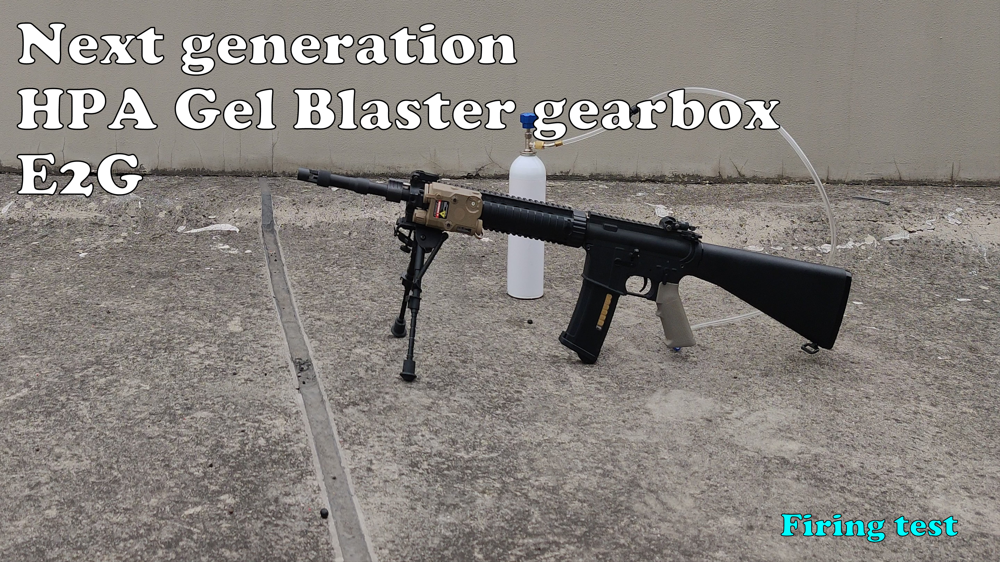

<p align="center">
  
</p>

<h1 align="center">E2G</h1>

<p align="center"><strong>Electro-pneumatic solenoid control research platform</strong></p>

<p align="center">
  Open hardware, printable mechanical parts, and Arduino firmware for experimental pneumatic actuator control.
</p>

<p align="center">
  <a href="README.zh-CN.md">中文说明</a> ·
  <a href="#demonstration-videos">Demonstration videos</a> ·
  <a href="#repository-layout">Repository layout</a>
</p>



## Overview

E2G is a compact electro-pneumatic research platform built around an Arduino-compatible controller, solenoid valve output, auxiliary motor or feed output, two digital control inputs, battery-voltage sensing, configurable pulse timing, and EEPROM-backed settings.

The repository preserves the original engineering files used during development. It contains four printable STL parts, fabrication-ready Gerber archives, two firmware generations, the project logo, a controller reference image, and links to the original demonstrations. The HPA gel-blaster setup shown in the videos is one experimental application of the controller.

## Features

- Arduino-compatible firmware using only the standard `EEPROM` library
- Configurable solenoid pulse duration and cycle rate
- Two selectable input modes
- Auxiliary output synchronized with the solenoid cycle
- Serial configuration and diagnostic interface at 9600 baud
- Persistent configuration storage in EEPROM
- Battery-voltage monitoring in the v2 firmware
- Four printable mechanical components
- Gerber packages for two PCB design families and their revisions

## Hardware interface

The firmware uses the following pin assignment.

| Signal | Arduino pin | Purpose |
|---|---:|---|
| `VALVE` | D6 | Solenoid-valve control output |
| `EXT` | D5 | Reserved extension output |
| `MAG` | D3 | Auxiliary actuator or feed output |
| `TRIGGER` | A3 | Primary active-low input |
| `SELECTOR` | A2 | Mode-selection input |
| `BAT` | A1 | Battery-sense analog input |

The reference schematic in [`assets/controller-schematic.png`](assets/controller-schematic.png) shows the Arduino Pro Mini and Bluetooth serial interface used in one controller revision. Verify voltage levels, driver polarity, flyback protection, and the battery-sense divider against the fabricated PCB before connecting a solenoid.

## Firmware

Two firmware generations are included.

| Directory | Status | Notes |
|---|---|---|
| [`firmware/e2g-controller-v2`](firmware/e2g-controller-v2) | Recommended | English serial interface, first-run EEPROM initialization, battery check, help, save, and reset commands |
| [`firmware/legacy-controller`](firmware/legacy-controller) | Historical | Earlier Chinese test firmware retained for reference |

To flash the recommended firmware, open `e2g-controller-v2.ino` in the Arduino IDE, select the matching Arduino-compatible board and processor, and upload it. Open the serial monitor at **9600 baud** with newline termination.

### Serial commands

| Command | Function |
|---|---|
| `READ` | Print the current configuration and sensed battery voltage |
| `SAVE` | Store the current configuration in EEPROM |
| `HELP` | Print the command reference |
| `AUTO n m` | Configure the two events in mode 1 |
| `SEMI n m` | Configure the two events in mode 2 |
| `RATE n` | Set the cycle rate between 5 and 50 cycles per second |
| `PUSH n` | Set the valve-on duration in milliseconds |
| `MAGG n` | Run the auxiliary output for 0 to 15 seconds |
| `SHOT n` | Run 0 to 100 requested cycles from the serial interface |
| `RESET` | Restore the firmware defaults |

The historical code uses application-specific words such as `shoot` and `fireRate`. In controller terms, these represent one output cycle and the requested cycle frequency.

## Mechanical files

The [`hardware/3d-models`](hardware/3d-models) directory contains the four original STL models.

| File | Original part name |
|---|---|
| `pusher-nozzle.stl` | 推嘴 |
| `front-v2.stl` | FrontV2 |
| `guide.stl` | guided |
| `rear-v3-h1.stl` | RearV3_H1 |

The STL files are provided in their original geometry. Confirm units and fit with a test print before producing final parts.

## PCB files

Fabrication archives are stored under [`hardware/pcb`](hardware/pcb).

- `interface-board` contains the two original interface-board Gerber packages dated 2021-03-05 and 2021-03-07.
- `controller-board-archive` contains the E2G controller Gerber revisions dated 2021-03-07 and 2022-10-05.

Each ZIP is preserved as supplied so it can be uploaded directly to a PCB fabricator after inspection. Review the drill, outline, copper, mask, paste, and silkscreen layers in a Gerber viewer before ordering.

## Bill of materials

The BOM is currently incomplete and is provided for component identification only. The spring and small O-ring dimensions have yet to be uploaded.

- [Bilingual BOM](hardware/BOM.md)
- [CSV BOM](hardware/BOM.csv)

The BOM covers the pneumatic parts, seals, controller modules, connectors, regulators, MOSFET, and switches identified from the original build records. Screw quantity and unlisted passive components depend on the hardware revision.

## Demonstration videos

<table>
  <tr>
    <td align="center">
      <a href="https://www.youtube.com/watch?v=JNImz593QCc">
        <br>
        Demonstration video 1
      </a>
    </td>
    <td align="center">
      <a href="https://www.youtube.com/watch?v=OADASA6Phwc">
        <br>
        Demonstration video 2
      </a>
    </td>
  </tr>
</table>

## Repository layout

```text
E2G/
├── assets/                  Logos, schematic reference, and demonstration image
├── firmware/
│   ├── e2g-controller-v2/   Recommended Arduino firmware
│   └── legacy-controller/   Historical Arduino firmware
├── hardware/
│   ├── BOM.md               Bilingual bill of materials and procurement notes
│   ├── BOM.csv              Spreadsheet-ready bill of materials
│   ├── 3d-models/           Four STL parts
│   └── pcb/                 Gerber fabrication archives
├── LICENSE
├── README.md
└── README.zh-CN.md
```

## Engineering notes

- The solenoid and other inductive loads require a correctly rated external driver and flyback suppression. Do not drive them directly from a microcontroller pin.
- Confirm supply voltage, current capacity, pressure ratings, electrical isolation, and fail-safe behavior for the intended actuator before testing.
- The battery calculation in the firmware reflects the original prototype. Calibrate it for the resistor divider and ADC reference used by your board.
- The firmware is blocking by design and uses `delay()`. Applications requiring concurrent control or deterministic fault handling should replace the timing loop with a non-blocking state machine.

## Credits

Designed and released by **rayfor&LLK industry committee**.

## License

This project is released under the [MIT License](LICENSE).

