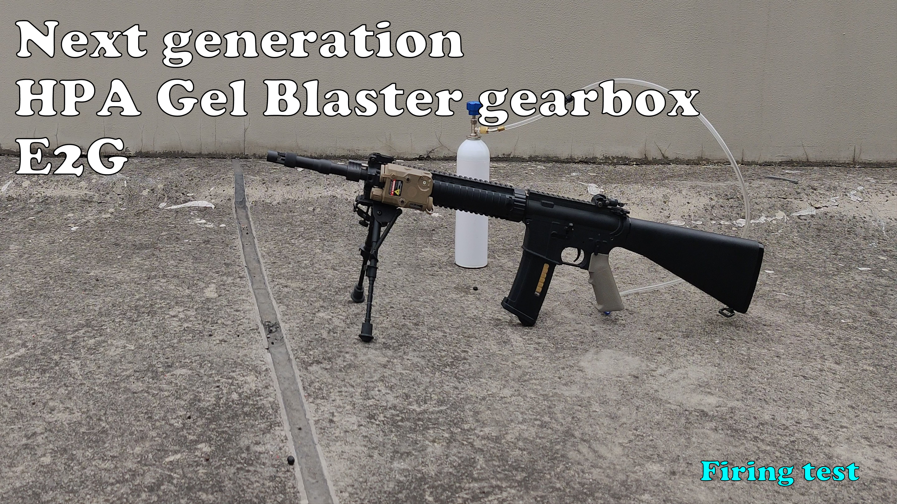

<p align="center">
  
</p>

<h1 align="center">E2G</h1>

<p align="center"><strong>电气动电磁阀控制研究平台</strong></p>

<p align="center">
  <a href="README.md">English</a> ·
  <a href="#演示视频">演示视频</a> ·
  <a href="#仓库结构">仓库结构</a>
</p>



## 项目简介

E2G 是一个紧凑型电气动控制研究平台，由 Arduino 兼容控制器、电磁阀输出、辅助执行器输出、两个数字输入、电池电压检测、脉冲时序配置和 EEPROM 参数存储组成。

本仓库保存了项目开发时使用的原始工程资料，包括 4 个可打印 STL 零件、可供生产检查的 Gerber 压缩包、两代 Arduino 固件、项目 Logo、控制器参考图以及原始演示视频链接。视频中的 HPA Gel Blaster 是该控制器的一项实验应用。

## 主要功能

- 仅依赖 Arduino 标准 `EEPROM` 库
- 可配置电磁阀开启时长和循环频率
- 两种可选择的输入模式
- 与电磁阀周期同步的辅助输出
- 9600 波特率串口配置和诊断
- EEPROM 持久化参数
- v2 固件提供电池电压检测
- 4 个可打印机械零件
- 两类 PCB 设计及其修订版 Gerber 文件

## 硬件接口

| 信号 | Arduino 引脚 | 用途 |
|---|---:|---|
| `VALVE` | D6 | 电磁阀控制输出 |
| `EXT` | D5 | 预留扩展输出 |
| `MAG` | D3 | 辅助执行器或供给机构输出 |
| `TRIGGER` | A3 | 主动低电平控制输入 |
| `SELECTOR` | A2 | 模式选择输入 |
| `BAT` | A1 | 电池电压模拟输入 |

[`assets/controller-schematic.png`](assets/controller-schematic.png) 是其中一个控制板版本的 Arduino Pro Mini 和蓝牙串口连接参考图。连接电磁阀前，请根据实际 PCB 核对电平、驱动极性、续流保护和电池采样分压。

## 固件说明

| 目录 | 状态 | 说明 |
|---|---|---|
| [`firmware/e2g-controller-v2`](firmware/e2g-controller-v2) | 推荐 | 英文串口界面，包含 EEPROM 首次初始化、低电压检查、帮助、保存和恢复默认设置 |
| [`firmware/legacy-controller`](firmware/legacy-controller) | 历史版本 | 早期中文测试固件，作为开发记录保留 |

烧录推荐版本时，在 Arduino IDE 中打开 `e2g-controller-v2.ino`，选择与硬件一致的开发板和处理器后上传。串口监视器设置为 **9600 baud**，行结束符选择换行。

### 串口命令

| 命令 | 功能 |
|---|---|
| `READ` | 显示当前参数和电池采样电压 |
| `SAVE` | 将当前参数写入 EEPROM |
| `HELP` | 显示命令帮助 |
| `AUTO n m` | 配置模式 1 的两个输入事件 |
| `SEMI n m` | 配置模式 2 的两个输入事件 |
| `RATE n` | 设置每秒 5 至 50 次的循环频率 |
| `PUSH n` | 设置电磁阀开启时间，单位为毫秒 |
| `MAGG n` | 运行辅助输出 0 至 15 秒 |
| `SHOT n` | 通过串口请求运行 0 至 100 个周期 |
| `RESET` | 恢复固件默认参数 |

历史代码沿用了 `shoot`、`fireRate` 等应用名称。在通用控制器语境中，它们分别表示一次输出周期和设定的循环频率。

## 机械模型

[`hardware/3d-models`](hardware/3d-models) 包含 4 个原始 STL 模型。

| 文件 | 原始零件名 |
|---|---|
| `pusher-nozzle.stl` | 推嘴 |
| `front-v2.stl` | FrontV2 |
| `guide.stl` | guided |
| `rear-v3-h1.stl` | RearV3_H1 |

模型保留原始几何数据。正式打印前请确认单位，并先做小范围试装。

## PCB 文件

生产文件位于 [`hardware/pcb`](hardware/pcb)。

- `interface-board` 保存日期为 2021-03-05 和 2021-03-07 的两份接口板 Gerber 包。
- `controller-board-archive` 保存日期为 2021-03-07 和 2022-10-05 的 E2G 控制板 Gerber 修订版。

所有 ZIP 均按原始形式保留。下单前应使用 Gerber 查看器检查钻孔、外形、铜层、阻焊、钢网和丝印层。

## 物料清单

主要物料清单提供两种格式。

- [中英双语 BOM 和采购检查说明](hardware/BOM.md)
- [CSV 格式 BOM](hardware/BOM.csv)

清单包括原始装配记录中能够确认的气动件、密封件、控制模块、连接器、稳压器、MOSFET 和开关。螺丝数量及未列出的无源器件随硬件版本而变化。

## 演示视频

- [E2G 演示视频 1](https://www.youtube.com/watch?v=JNImz593QCc)
- [E2G 演示视频 2](https://www.youtube.com/watch?v=OADASA6Phwc)

## 仓库结构

```text
E2G/
├── assets/                  Logo、控制器参考图和演示图片
├── firmware/
│   ├── e2g-controller-v2/   推荐 Arduino 固件
│   └── legacy-controller/   历史 Arduino 固件
├── hardware/
│   ├── BOM.md               中英双语物料清单和采购说明
│   ├── BOM.csv              可导入表格软件的物料清单
│   ├── 3d-models/           4 个 STL 零件
│   └── pcb/                 Gerber 生产文件
├── LICENSE
├── README.md
└── README.zh-CN.md
```

## 工程注意事项

- 电磁阀等感性负载需要额定参数合适的外部驱动和续流保护，不能由单片机引脚直接驱动。
- 测试前需确认执行器的供电电压、电流、压力等级、电气隔离和失效保护方式。
- 固件中的电池电压计算来自原型机，使用其他采样分压或 ADC 参考电压时需要重新校准。
- 当前固件使用 `delay()` 实现阻塞式时序。如需并行控制或确定性的故障处理，应改用非阻塞状态机。

## 署名

本项目由 **rayfor&LLK industry committee** 设计并开源。

## 许可证

项目采用 [MIT License](LICENSE)。

